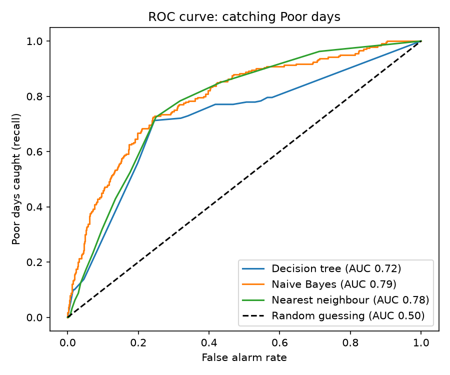

# Part E: Evaluation

## Split
By time: older 80% = train, newest 20% = test, with a 24-row gap (each answer looks 24 hours ahead).

## 1. Test results (baseline: always guess Moderate = 63.1%)

| model | baseline_% | accuracy_% | f1_macro | poor_recall | poor_precision | auc_poor |
|---|---|---|---|---|---|---|
| Decision tree | 63.1 | 68.1 | 0.497 | 0.096 | 0.535 | 0.717 |
| Naive Bayes | 63.1 | 54.8 | 0.507 | 0.317 | 0.517 | 0.792 |
| Nearest neighbour | 63.1 | 67.8 | 0.456 | 0.0 | 0.0 | 0.776 |

## 2. Why these metrics suit this user
- **Poor recall:** the user is a parent, school or outdoor worker. A Poor day with no warning is the worst mistake. Recall is the share of real Poor hours the model caught.
- **Poor precision:** if the model warns all the time, recall looks great but nobody trusts the warnings. Precision is the share of warnings that were right.
- **Macro F1:** Poor is just 15.1% of test hours, so accuracy can look fine while Poor is ignored. Macro F1 counts Good, Moderate and Poor equally.

## 3. ROC curve and AUC (Poor vs the rest)

## 4. Confusion matrices (rows = actual, columns = predicted)

### Decision tree

| Actual | Pred Good | Pred Moderate | Pred Poor |
|---|---|---|---|
| Good | 167 | 180 | 1 |
| Moderate | 91 | 894 | 19 |
| Poor | 1 | 216 | 23 |

### Naive Bayes

| Actual | Pred Good | Pred Moderate | Pred Poor |
|---|---|---|---|
| Good | 301 | 44 | 3 |
| Moderate | 440 | 496 | 68 |
| Poor | 34 | 130 | 76 |

### Nearest neighbour

| Actual | Pred Good | Pred Moderate | Pred Poor |
|---|---|---|---|
| Good | 204 | 144 | 0 |
| Moderate | 129 | 875 | 0 |
| Poor | 8 | 232 | 0 |

## 5. Cross-validation on the train pile (5 folds, time order, mean +/- spread)

| model | accuracy_% | f1_macro |
|---|---|---|
| Decision tree | 69.2 +/- 2.8 | 0.493 +/- 0.035 |
| Naive Bayes | 63.2 +/- 8.6 | 0.479 +/- 0.035 |
| Nearest neighbour | 72.2 +/- 2.8 | 0.478 +/- 0.016 |

## 6. Cost matrix and operating threshold

|  | cost |
|---|---|
| Poor day, warned | 0 |
| Poor day, not warned | 5 |
| Not Poor, warned | 1 |
| Not Poor, not warned | 0 |

The costs are our own choice: a missed Poor day is worse than a false alarm. The threshold was chosen on a validation slice from the end of the train pile, not on the test pile. The default 0.5 was not kept.

| model | chosen_threshold | missed_at_0.5 | alarms_at_0.5 | cost_at_0.5 | missed_at_chosen | alarms_at_chosen | cost_at_chosen |
|---|---|---|---|---|---|---|---|
| Decision tree | 0.5 | 217 | 21 | 1106 | 217 | 21 | 1106 |
| Naive Bayes | 0.5 | 164 | 71 | 891 | 164 | 71 | 891 |
| Nearest neighbour | 0.3 | 240 | 0 | 1200 | 225 | 28 | 1153 |
